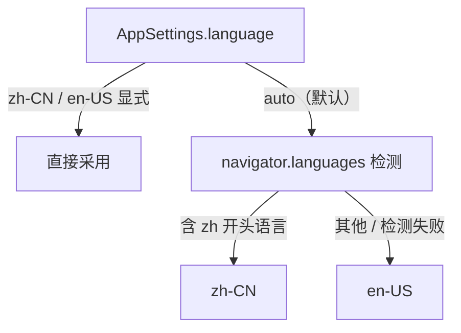

# 中英双语 i18n 改造计划

> 状态：进行中（阶段 0 已完成） · 创建于 2026-10-12 · 开工于 2026-10-12
> 背景：AppImage 官方目录收录 PR [AppImage/appimage.github.io#9068](https://github.com/AppImage/appimage.github.io/pull/9068) — 目录 CI 在英文 locale 的 runner 上启动 AppImage 截图判语言，收录条件是「非中文系统语言下默认显示英文界面」（中文 locale 下仍默认中文）。

## 目标

1. 主应用（Web + 桌面端）、Companion 管理页、`/download` 营销页完成中英双语。
2. 语言跟随系统 locale 自动选择，用户可在设置中显式切换并持久化。
3. 发送模型的提示词模式模板跟随界面语言。
4. 发布 desktop-v0.4.0，回复 PR #9068 请目录维护者重跑 CI（附带修复 `.DirIcon` 缺失问题，见阶段 6）。

## 已拍板决策

| 决策项 | 结论 |
| :--- | :--- |
| i18n 框架 | vue-i18n v11（`legacy: false` 组合式 + 模板 `$t` 全局注入） |
| 提示词模板 | 跟随 locale：zh 环境发中文模板，en 环境发英文模板 |
| 持久化中文数据（默认会话标题、图片命名、遮罩名等） | 不迁移；新数据按生成时语言写入；接受列表中英文混杂 |
| 改造范围 | 主应用 + Companion 管理页 + `/download` 营销页（Companion CLI / 服务端文案不做，见「不做清单」） |

以下实现细节由上述决策推定，视为已定死，施工时不再开放选择：

| 项 | 定案 |
| :--- | :--- |
| 语言代码 | `zh-CN` / `en-US`；设置项三选：跟随系统（默认）/ 中文 / English |
| 语言解析优先级 | 显式设置 → localStorage 镜像 → `navigator.languages` 检测 → `en-US` 兜底 |
| 桌面端语言检测 | 直接用 webview 的 `navigator.language`（WKWebView / WebView2 / WebKitGTK 均透传系统语言），不装 tauri-plugin-locale、不改 Rust 检测逻辑 |
| `fallbackLocale` | `en-US` |
| 词库打包 | 两语言全量打进主包，不做按语言懒加载（词条约千条，体积影响在阶段 0 量化验收） |
| 词库组织 | `src/locales/zh-CN/`、`src/locales/en-US/` 目录，按域分模块（common / settings / chat / library / generation / errors / prompt / download / companion），`index.ts` 聚合；`en-US` 词库类型定义为 `typeof zhCN` 深层同构，由 vue-tsc 强制 |
| 词库预编译 | 安装 `@intlify/unplugin-vue-i18n`，消除运行时消息编译器 |
| `/download` 双语路由 | `/download` 保持中文（保住现有 URL 与 SEO 权重），新增 `/en/download` 英文版，两页互链 + `hreflang` 互指；英文浏览器访问 `/download` 时顶部显示非阻断提示条引导到英文页，**不自动跳转** |
| Companion 管理页 | 原生 JS 迷你字典：HTML 节点标 `data-i18n-key`，`app.js` 内置 zh/en 字典；`?lang=` 参数 > `navigator.language`；选择存 localStorage |
| 桌面 Companion 子窗口标题 | `lib.rs` 中「Companion 管理页」改为英文 `Companion Admin`（标题栏短文案用英文即可，页面内标题走管理页自己的 i18n） |
| 嵌入协议 | `QiankunProps` 增加可选 `locale?: 'zh-CN' | 'en-US'`，嵌入态优先于自动检测；不加 postMessage 动态切换消息 |
| README | 顶部加英文简介段 + 更新 repo description / topics；不全文翻译 |
| release notes 模板 | 改双语，英文在前 |

## 总体设计

### 语言解析链

### vue-i18n 接入

- `src/i18n/index.ts`：`createI18n({ legacy: false, globalInjection: true, locale, fallbackLocale: 'en-US', messages })`；同文件导出 `t`（绑定 `i18n.global.t`），供 stores / services / promptBuilder 等非组件模块使用。
- 组件模板用 `$t`，`<script setup>` 用 `useI18n()`。
- 挂载点：`App.vue`（studio 应用）与 `entry-ssg.ts`（SSR 侧，download 页按路由注入对应 locale）。
- 「格式化 locale」（`Intl` 系列、`localeCompare`）从 `i18n.global.locale` 派生。

### 设置持久化

- `AppSettings` 增加 `language: 'auto' | 'zh-CN' | 'en-US'`，默认 `'auto'`。
- 持久化链路照现有模式：`settingsStore.currentSettings` → IndexedDB `settings` 单记录；`normalizeSettings` 对旧记录 / 旧备份兜底补 `'auto'`，无需迁移脚本（见「迁移条款」）。
- localStorage 镜像键 `gpt-image-studio:language`（沿用 `SETTINGS_STORAGE_KEYS` 模式），启动期同步读取，避免刷新时闪回中文。

### SSG 与静态壳

- 现状：`index.html` 壳（`lang="zh-CN"`、title / meta / splash 文案）是构建期中文，JS 执行前可见；主应用不走 hydration、客户端整树重建，切换闪烁由 splash 掩盖。
- 方案：`index.html` 注入一段首帧前内联脚本 —— 按解析链确定语言，设置 `<html lang>` 并替换 splash / tagline / aria-label（节点标 `data-i18n-shell`，脚本内联 zh / en 两条字符串）；主应用 mount 后按当前语言更新 `document.title`（词库 `app.title`）。
- 根路径 `/` 的 meta / OG / JSON-LD 保持中文为主（SEO 策略以中文关键词为主，见 `docs/guides/seo-strategy.md`），不在本期改动。
- `/download` 与 `/en/download` 双静态路由：`vite.config.ts` 的 `includedRoutes` 扩为 `['/', '/download', '/en/download']`；`entry-ssg.ts` 按 pathname 选组件（同一个 `DownloadPage`，传 locale prop）；`ssgTemplate.ts` 按 locale 输出对应语言的 meta / JSON-LD。

### 错误消息结构化（errors.ts 重构，阶段 1 前置）

- 现状：`src/shared/errors.ts` 的 `isApiConfigurationError` 用「请先在设置里填写」等**中文文本 pattern** 匹配分类错误；文案换成英文后该分类直接失灵。
- 方案：定义 `ApiClientError extends Error { code: ApiErrorCode }`；`imagesApi/*`、`companionApi`、Companion 连接等抛错点补 `code`；`isApiConfigurationError` 改查 `code`，删除文本 pattern；展示层用 `t('errors.api.<code>')` 渲染，原始 detail 附后。
- Companion API 回流的服务端原文错误：Web 端用本地化模板包装后透传原文，不翻译服务端消息（服务端文案不在本期范围）。

### 提示词模板跟随 locale

- `promptBuilder.ts` 的模式标签（安全 / 创意 / 成人）走词库 `prompt.mode.*`；模式说明与拼接模板（「请把用户原始提示词作为最高优先级…」等）在词库建 `prompt.template.*`，zh / en 各一套完整模板，请求时按当前 locale 取用。
- 聊天历史继续保存用户原始提示词（现有约定不变，包装只发生在请求时）。
- `promptRewriteGuard` 默认前缀已是英文，不动。

### 持久化数据生成策略

- 生成时取词库文案：默认会话标题（「新的图片创作」）、导入图片命名（「导入图片-」）、参考图描述（「用户导入的参考图」）、遮罩名（「局部编辑遮罩」）。
- 旧数据不迁移、原样展示；UI 引用这些名称时（删除确认等）用存储值拼参数，不二次翻译。

## 分阶段任务与门禁

> 施工纪律：分支 `honlnk/dev`，Conventional Commits（建议 scope 用 `i18n`，如 `feat(i18n): ...`）；每阶段门禁 = `pnpm typecheck` + `pnpm test` 全绿 + 该阶段验收项通过 + 本文档施工日志落盘；门禁不过不开下一阶段。

### 阶段 0：i18n 基建（估 1–2 天）

任务：

1. 安装 `vue-i18n@^11` + `@intlify/unplugin-vue-i18n@^11`，`vite.config.ts` 配置预编译，验证 vite-ssg 兼容（`pnpm build` + `pnpm preview` 可用）。
2. `src/i18n/index.ts`：createI18n、`resolveInitialLocale()`（localStorage 镜像 > 显式设置 > navigator 检测）、导出 `t`。
3. 词库骨架：`src/locales/zh-CN/` 与 `en-US/` 分模块目录，en-US 深层同构类型约束生效。
4. `AppSettings.language` 全链路：`types/studio.ts`、`services/settings.ts`（StoredAppSettings + normalizeSettings）、`settingsStore`、localStorage 镜像；`GeneralSettingsPanel` 增加「界面语言」三选项。
5. `index.html` 首帧内联脚本 + splash `data-i18n-shell` 标注 + mount 后 `document.title` 更新。
6. 试点：设置面板约 20 条文案先接 `$t`，验证全链路。

验收（可执行）：

- typecheck / test 全绿；词库 key 完整性测试（zh / en 深层 key 集合相等）已生效。
- 手动：切换语言即时生效；刷新不闪回（localStorage 镜像生效）；清空 localStorage 后，en 环境（浏览器改 Accept-Language 或 `--lang=en-US` 启动）默认英文。
- 记录 dist 体积前后对比（vue-i18n + 词库的净增）。

### 阶段 1：errors.ts 结构化重构（估 0.5–1 天）

任务：定义 `ApiErrorCode`；抛错点补 code；`isApiConfigurationError` 改 code 判定并删除中文文本 pattern；错误展示接 `t('errors.*')`。

验收：`isApiConfigurationError` 按 code 分类的单测（覆盖原三条文本 pattern 对应的场景）；typecheck / test 绿。

### 阶段 2：主应用文案全量抽取（估 3–5 天，分四波）

- **2a**：settings 13 个面板 + `SettingsModal` tab 导航 + `BatchOperationsPanel`。
- **2b**：chat 13 个组件 + studio 6 个（`ChatWorkspace`、`ImageLibrary`、`ConversationSidebar`、各模态）。
- **2c**：image-library 5 个 + ui 基础组件剩余硬编码（`ConfirmDialog`「取消」、`NoticeToast` aria-label、`ConfirmInputModal`）+ `App.vue` / pages 根组件。
- **2d**：动态消息层 — `generationStore` / `imagesStore` / `conversationsStore` / `settingsStore` toast 与确认文案、`feedbackStore` 36 个调用点、`useStudioViewModel`（含 `reportStorageError`）、`generationLabels.ts`、`dateTime.ts`、`fileFormatters.ts`、`analyticsExport.ts`、`desktopUpdate.ts`、备份 / 恢复、Companion 连接。

每波门禁：typecheck / test 绿；该波文件通过 CJK 硬编码扫描；对应组件双语走查（切语言截图或手动）。

收尾门禁：`src` 全域 CJK 扫描零命中（白名单：`locales/`、测试文件）；12 个测试文件的 58 处中文 UI 断言全部改为 key 断言或按 locale 输出断言。

### 阶段 3：格式化 / 排序 / 提示词模板 / 桌面壳（估 1.5–2 天）

任务：

- `Intl.DateTimeFormat("zh-CN")` ×3（`shared/dateTime.ts`、`PromptGuardSettingsPanel`、`FavoritePromptsPanel`）、`localeCompare(…, "zh-Hans")` ×2（`ImageLibrary.vue`、`BatchOperationsPanel.vue`）改动态 locale；`dateTime.ts` 相对时间改 `Intl.RelativeTimeFormat`。
- `analyticsExport.ts` Markdown 报告表头 / 说明按导出时 locale。
- `promptBuilder.ts` 标签 + 模板词库化（zh / en 两套），`promptBuilder.test.ts` 按 locale 参数化。
- 桌面：`lib.rs` 子窗口标题改英文、Err 消息英文；`desktopCompanion.ts` 错误回流本地化包装。

验收：测试绿；en locale 下抽查导出报告、名称排序、相对时间、提示词拼接输出正确。

### 阶段 4：Companion 管理页双语（估 1 天）

任务：`companion/src/admin/index.html` 文案节点标 `data-i18n-key`（约 58 行静态文案）；`app.js` 注入 zh / en 字典 + `t(key, params)` + `?lang=` 参数 + localStorage 持久化；132 行动态状态文本改 key + 插值。

验收：浏览器手动走查两语言主要流程（状态总览、凭据 CRUD、存储切换、日志）；`pnpm typecheck:companion` 不受影响。

### 阶段 5：/download 双语 + SEO（估 1–1.5 天）

任务：`content.ts` 双语两套（title / description / FAQ 结构对齐）；`/en/download` 路由（`vite.config.ts` includedRoutes、`entry-ssg.ts`、`main.ts` 的 `isDownloadPagePath` 兼容 `/en/download`）；`ssgTemplate.ts` 按 locale 出 meta / JSON-LD；两页互链 + `hreflang`；英文浏览器访问 `/download` 的提示条。

验收：`pnpm build` 产出两份静态页且各自 meta / JSON-LD 语言正确（`ssgTemplate.test.ts` 扩双语断言）；`pnpm preview` 下互链与提示条可用（注意 GitHub Pages 子路径 base，`dirStyle: 'nested'` 已有先例）。

### 阶段 6：收尾与发布（估 1 天 + 发布流程）

任务：

1. README 顶部英文简介段、repo description / topics 更新；release notes 模板（`.github/release-notes-desktop.md`）改双语。
2. 嵌入协议 `locale` props + `qiankun-embed` 测试同步。
3. `AGENTS.md` Conventions 增加约定：**新增用户可见文案一律走词库 `t()`，禁止硬编码中文 / 英文 UI 字符串**；docs 索引同步（见「文档同步计划」）。
4. **`.DirIcon` 验证与修复**：下载 desktop-v0.3.2 的 AppImage 检查 squashfs 内 `.DirIcon`；若缺失，修 Tauri 打包配置并本地重建验证（可下载目录库的 `appdir-lint.sh` 预检）。
5. 全量回归：typecheck / test、双语言视觉走查清单（设置 / 生成 / 图库 / 备份主路径）、桌面端英文环境冒烟（`LANGUAGE=en_US.UTF-8` 启动或改系统语言）。
6. 发布 desktop-v0.4.0（tag 驱动 CI），回复 PR #9068 说明语言策略与 `.DirIcon` 修复，请维护者重跑 CI。

验收：en 环境启动桌面端默认英文；发布产物含修复后的 AppImage；PR 已回复。

## 守护机制（防回潮）

1. **key 完整性测试**：`src/i18n/i18n-keys.test.ts` 深遍历 zh-CN / en-US 词库，断言 key 集合相等。
2. **同构类型**：en-US 词库类型为 `typeof zhCN`，缺模块 / 缺 key 直接 typecheck 失败。
3. **CJK 硬编码扫描**：脚本剥离注释后扫描 `src/**/*.{vue,ts}` 与 `companion/src/admin/` 的中文字符串字面量（白名单：`locales/`、`*.test.ts`），挂进 `pnpm test`；阶段 2 收尾起作为常驻门禁。
4. **AGENTS.md 约定**：新文案必须走词库（阶段 6 写入）。

## 不做清单（本期显式排除）

- Companion CLI / 服务端 API 文案（约 900 行）— 终端与 API 用户以中文为主；回流错误由 Web 端本地化包装透传原文。
- `docs/` 下 65 篇中文文档翻译；README 仅加英文摘要段。
- 主应用 `/` 的多语言 SSG 路由（如 `/en/`）— 主应用客户端切语言已满足需求与目录要求。
- 第三语言及以上；翻译平台（Crowdin 等）与在线语言服务。
- postMessage 动态语言切换消息（嵌入态 props 一次性注入即可）。
- 旧持久化中文数据迁移（已拍板接受混杂）。
- `promptRewriteGuard` 默认前缀调整（本就是英文）。

## 新旧机制替代表

| 旧机制 | 去向 |
| :--- | :--- |
| 组件 / store / service 硬编码中文文案 | 替换为 `$t()` / `t()`，旧字符串删除，不并存 |
| `errors.ts` 中文文本 pattern 分类 | 替换为 `ApiErrorCode` 结构化判定，文本 pattern 删除 |
| `Intl.DateTimeFormat("zh-CN")` ×3 | 动态当前 locale |
| `localeCompare(…, "zh-Hans")` ×2 | 动态当前 locale |
| `dateTime.ts` 手写中文相对时间 | `Intl.RelativeTimeFormat` 按当前 locale |
| `promptBuilder.ts` 中文模板 | zh / en 两套模板入词库，请求时按 locale 取（中文模板保留进词库，不删除） |
| `lib.rs` 子窗口中文标题 | 改英文 `Companion Admin` |
| `/download` 单语中文页 | 保留为中文页 + 新增 `/en/download`，并存互链 |
| `download/content.ts` 单语文案对象 | 双语两套对象并存（结构对齐） |

## 迁移条款

- `AppSettings.language`：旧设置记录与旧备份均无此字段，`normalizeSettings` 兜底 `'auto'`，无需迁移脚本；恢复旧备份时保留恢复前的显式语言选择（备份值 → 当前值 → auto），属预期行为。
- 持久化中文名称数据（会话标题 / 图片命名 / 遮罩名）：不迁移、原样展示（已拍板）。
- localStorage：仅新增 `gpt-image-studio:language` 键，既有键不动。
- 版本：desktop-v0.3.x → **v0.4.0**（新能力升 minor）。

## 风险与应对

| 风险 | 应对 |
| :--- | :--- |
| vue-i18n 与 vite-ssg 兼容问题 | 阶段 0 第一件事就验证 build + preview；主应用不走 hydration、SSG 只渲染壳，实际风险低；download 页按路由注入 locale |
| 词条遗漏导致英文界面露中文 | `fallbackLocale: en-US` + key 完整性测试 + CJK 扫描门禁三重兜底 |
| 英文文案质量（机翻腔） | 阶段 2 开工前先定术语表（生成 / 编辑 / 参考图 / 遮罩 / 会话等核心词），关键路径文案人工过一遍 |
| 插值参数漏传 / 错传 | 词库同构类型约束 + 关键带参消息单测（沿用 `generationLabels.test.ts` 模式） |
| 目录 CI 重跑仍不过（`.DirIcon` 之外的新问题） | 阶段 6 用目录库的 `appdir-lint.sh` 本地预检打包产物 |
| 包体积净增 | 阶段 0 量化记录；词库约千条 + 预编译后预计净增 < 80KB（gzip 前），超标再议懒加载 |

## 工作量汇总

| 阶段 | 估时（工作日当量） |
| :--- | :--- |
| 0 基建 | 1–2 |
| 1 errors 重构 | 0.5–1 |
| 2 主应用抽取（四波） | 3–5 |
| 3 格式化 / 提示词 / 桌面壳 | 1.5–2 |
| 4 Companion 管理页 | 1 |
| 5 /download 双语 | 1–1.5 |
| 6 收尾与发布 | 1 + 发布流程 |
| 合计 | 约 9–13.5 |

## 文档同步计划

- 本文档在 `docs/plans/README.md` 索引中流转状态（已定稿待开工 → 进行中 → 已落地）；每阶段门禁通过后在本节下方追加施工日志。
- 施工日志格式：`日期 · 阶段 · 提交 hash · 验收结论 · 偏差记录`。
- `docs/plans/roadmap.md`「后续候选方向」追加 i18n 条目（开工时）。
- `AGENTS.md` Conventions 增词库约定（阶段 6）。
- `docs/architecture/architecture.md` 如涉及文案 / 格式化模块描述，按需小改。

## 施工日志

### 2026-10-12 · 阶段 0 · i18n 基建 · ✅ 门禁通过

**验收结论**

- `pnpm typecheck` / `pnpm test` 全绿（1438 tests，含新增：i18n 语言解析链 9 例、词库 key 完整性、CJK 基线扫描）。
- `pnpm build` + preview 冒烟通过：`/` 含首帧语言脚本与 splash；`/download` 的 splash 与首帧脚本被 ssgTemplate 正确剥离。
- 主 chunk 体积：142.7KB → 163.4KB gzip，**净增 +20.7KB**（预算 <80KB，达标）。
- 试点：GeneralSettingsPanel 全部文案接入 `$t`，新增「界面语言」三选项（跟随系统 / 中文 / English）。

**偏差记录**

1. **跳过 `@intlify/unplugin-vue-i18n`**：其消息预编译只作用于 JSON 资源；词库为 TS 模块，保留完整构建（含编译器）以换取「en-US = typeof zh-CN 深层同构」编译期守护。体积代价已计入净增。
2. **vite-ssg 兼容**（计划风险表预判成真）：需在 vite.config 显式 `define: { __VUE_PROD_DEVTOOLS__: ... }` + `ssr.noExternal: ['vue-i18n']`，否则 SSR 渲染阶段 `ReferenceError`。
3. **restore 旧备份的语言兜底增强**：`backups.ts` 恢复路径补 `language` 兜底为「备份值 → 当前设置 → auto」，比计划迁移条款描述的「旧备份一律回 auto」更保守（保留用户显式选择），行为变化已同步到迁移条款。
4. 施工日志不内嵌提交 hash（自指不可行），hash 由 git 历史按阶段提交自然对应。
